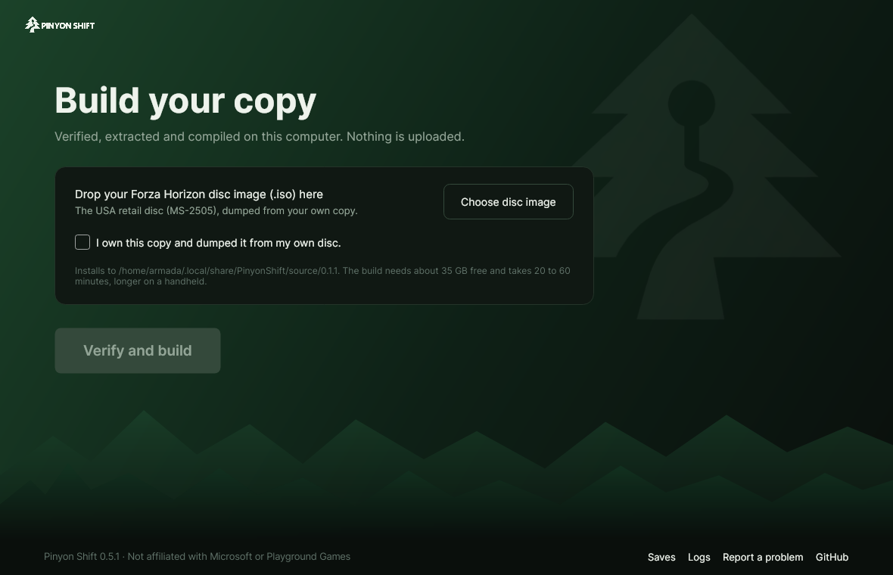
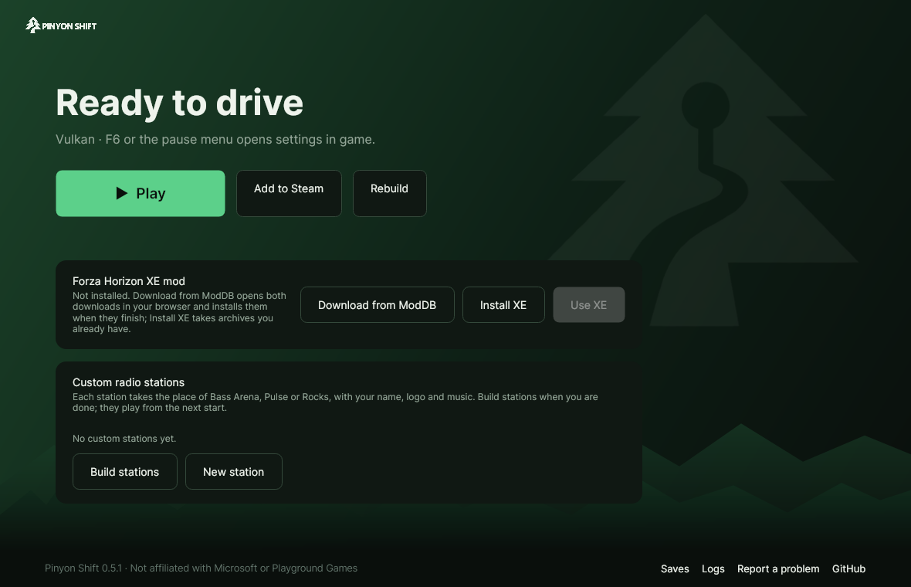

# pinyon-shift-arm64

Play [Pinyon Shift](https://github.com/arcanite24/pinyon-shift), the
ahead-of-time recompiled Xbox 360 *Forza Horizon*, natively on Snapdragon
handhelds running [ArmadaOS](https://armadaos.dev/), such as the Retroid
Pocket 6.

<p align="center">
  
  
</p>

Like upstream's own launchers, this one builds the game on the handheld from
your own disc. This repository holds no game code
([LEGAL.md](https://github.com/arcanite24/pinyon-shift/blob/main/docs/LEGAL.md)).

## Install

You need an ISO of your USA retail disc (`MS-2505`) and about 35 GB free.

1. In **Desktop Mode**, download `PinyonShift-Launcher-linux-arm64.tar.gz`
   from the [latest release](https://github.com/Ken5998/pinyon-shift-arm64/releases/latest),
   extract it to your home folder and start `PinyonShift/PinyonShiftLauncher`.
2. **Choose disc image**, confirm that you own it and press **Verify and
   build**. Keep the handheld on its charger: the build takes 25 to 60
   minutes. *Copying the game files* can stay at 0.0 GB for a few minutes
   before it starts counting.
3. Press **Play**, or **Add to Steam** to start the game from Gaming Mode like
   any other game.

The launcher keeps everything in `~/.local/share/PinyonShift` and installs
nothing on the system. When a new Pinyon Shift release passes this
repository's weekly check, the launcher offers the update.

## In game

- **Select + Start** (or **F6**) opens the settings menu.
- Pressing **both sticks** (or **F3**) shows the performance panel.
- The built-in controls reach the game only when Steam starts it. In Desktop
  Mode, start it from Steam too, from the entry **Add to Steam** made.

## Settings for the Retroid Pocket 6

With these, the Retroid Pocket 6 holds 60 fps, shadows included.

- Vulkan driver: open **Armada Control** in the Quick Access menu (**•••**),
  tab **Compatibility**, and pick **Pinyon Shift** in the list at the top.
  Under **Advanced**, press **Drivers** and set **Turnip** to **Devel**, a
  newer Mesa that ArmadaOS ships beside its stable one: with Stable, the
  shadows cost up to 15 fps. It applies when Steam starts the game. If there
  is no **Drivers** button, update ArmadaOS.
- ArmadaOS power profile: **Balanced**. Eco is much slower, and Performance
  only adds heat and fan noise: the GPU already runs at its top clock.
- In **settings > GRAPHICS**:
  - **GRAPHICS PRESET**: LOW-SPEC 60, with **RESOLUTION SCALE** 1X
  - **SHADOWS**: on
  - **SINGLE-PASS SCENE**: on
  - **REFLECTION UPDATES**: QUARTER
  - **SCENE SHADING**: COARSE
  - **TEXTURE GAMMA**: FAST (applies at the next start)
- In **settings > DISPLAY**: **OUTPUT SCALING** BILINEAR. FSR 1 and CAS are
  sharper at full screen but cost about 1 ms of GPU a frame.

Apart from the shadows, these are the choices of the Android build's SMOOTH
60 preset on the same chip, and the launcher starts the game with that build's
Adreno defaults too.
The game always draws at 1280×720 or more: a smaller window does not make it
faster.

## If MangoHud or the Steam overlay flickers

On the Retroid Pocket 6, MangoHud, the Steam overlay and the Quick Access
menu can flicker and break into blocks while the game itself looks fine (with
Force Composite on, the whole screen does). The kernel lets gamescope
interrupt the game's GPU work to draw them (GPU preemption), and on this
Adreno 740 the interruption corrupts what gamescope draws. Turning preemption
off fixes it without costing frame rate. In Desktop Mode, open Konsole and
run:

```bash
sudo rpm-ostree kargs --append=msm.enable_preemption=0
```

then restart. `sudo cat /sys/module/msm/parameters/enable_preemption` shows
`0` afterwards. To undo it, run
`sudo rpm-ostree kargs --delete=msm.enable_preemption=0` and restart.
`TU_DEBUG=noubwc %command%` in the launch options hides the flicker too, but
slows the game down.

## If something goes wrong

The launcher shows which step failed. Its **Logs** link opens the build or
game logs; attach them to an
[issue](https://github.com/Ken5998/pinyon-shift-arm64/issues).

## Developers

How the port works, building the game on a PC instead, and how releases are
made: [docs/DEVELOPMENT.md](docs/DEVELOPMENT.md).

## License

BSD 3-Clause, as upstream. The patches modify upstream files under their
BSD 3-Clause license. The sysroot holds Ubuntu packages under their own
licences, listed in it. None of this grants any rights to *Forza Horizon* or
Xbox software.
